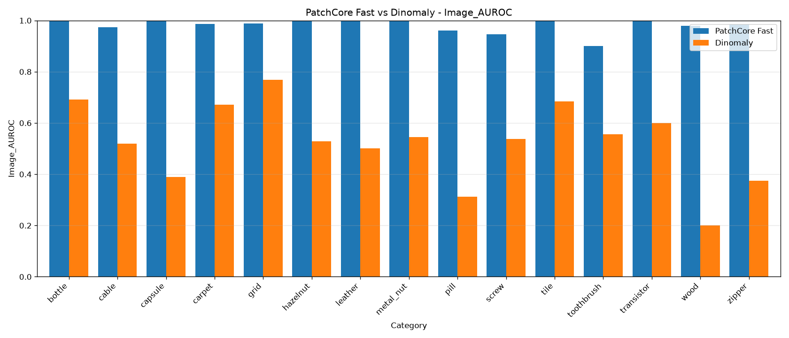
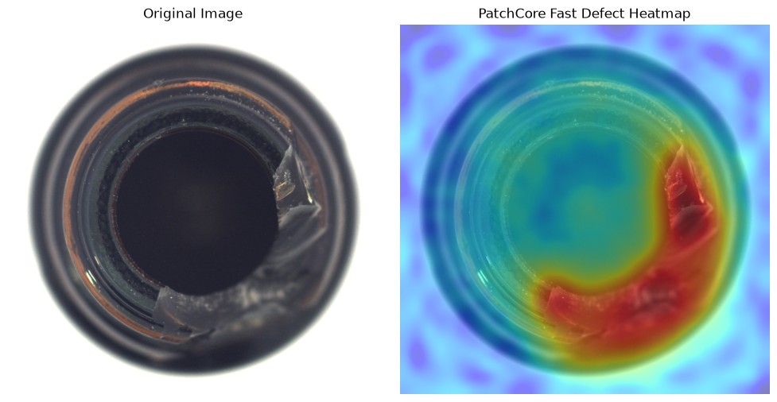
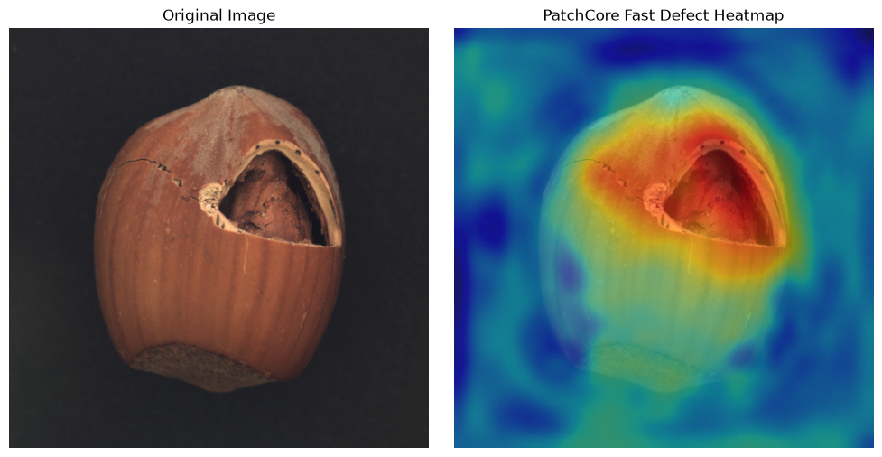
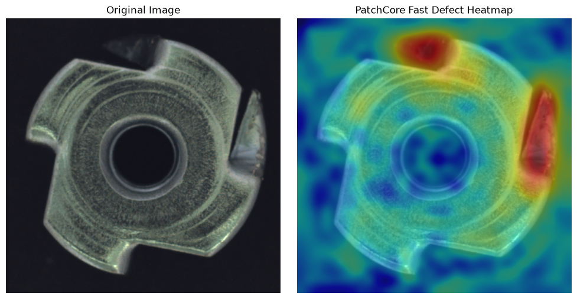
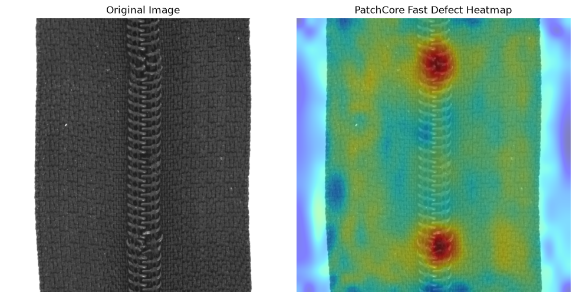

<div align="center">

# 🏭 Industrial Surface Defect Detection

**Unsupervised anomaly detection for automated visual quality inspection, benchmarked on all 15 MVTec AD categories.**


</div>

---

## 📌 Overview

Manual visual inspection on production lines is slow, subjective, and hard to scale. Collecting labelled defect images is also impractical, because defects are rare and highly varied.

This project tackles the problem with **unsupervised anomaly detection**: models are trained **only on defect-free ("good") images** and learn what normal looks like. Anything that deviates is flagged as a defect, and a **heatmap** shows where it is.

The repository covers the full workflow on the [MVTec AD](https://www.mvtec.com/company/research/datasets/mvtec-ad) industrial benchmark:

1. Dataset exploration and verification
2. A classical machine-learning baseline (GLCM texture + Canny edges + Isolation Forest)
3. **PatchCore** (original and a fast, coreset-reduced variant)
4. **Dinomaly** (a DINOv2 Vision Transformer based model)
5. Cross-model comparison, defect heatmaps, and an inference-speed benchmark

## 🏆 Key Results

PatchCore (Fast) achieved the strongest results across all **15 object and texture categories** (macro average):

| Metric | PatchCore (Fast) | Dinomaly* |
|---|---|---|
| Image AUROC | **98.1%** | 52.5% |
| Image F1-Score | **95.8%** | 81.4% |
| Pixel AUROC | **97.7%** | 48.4% |
| Pixel F1-Score | **56.3%** | 9.1% |

<sub>*Dinomaly was trained for a single epoch per category in this setup, so its scores reflect a short training budget and not the model's full potential. See [Limitations](#-limitations--future-work).</sub>

**Highlights**

- Perfect image-level AUROC (100%) on **bottle, hazelnut, leather, metal_nut, tile, and transistor**
- Pixel-level AUROC at or above **95%** on 14 of 15 categories, giving precise defect localization
- On the tile category, the classical ML baseline reached an Image AUROC of 62.5%, against **100%** for PatchCore, which shows the benefit of deep feature-based methods

<div align="center">

</div>

## 🔍 Sample Output

PatchCore (Fast) heatmaps highlight defect regions on real test images:

<div align="center">




</div>

Heatmaps for all 15 categories are in [`results/heatmaps/`](results/heatmaps/).

## 🧠 Methods

| Model | Approach | Notes |
|---|---|---|
| **Traditional baseline** | GLCM texture features and Canny edge density, scored with Isolation Forest | Handcrafted features, evaluated on the tile category |
| **PatchCore** | Memory bank of patch features from a pretrained CNN, scored by nearest-neighbour distance | Original configuration |
| **PatchCore (Fast)** | Same method with `coreset_sampling_ratio=0.01` | Much smaller memory bank, evaluated on all 15 categories |
| **Dinomaly** | DINOv2 ViT-B/14 encoder (with registers) and a reconstruction decoder | `vit_base_patch14_reg4_dinov2`, decoder depth 8 |

```
Normal images ──► Feature extraction ──► Model of "normal" ──► Anomaly score + heatmap
 (train only)      (CNN / ViT)            (memory bank /        (image-level decision,
                                           reconstruction)       pixel-level localization)
```

## 📊 Per-Category Results (PatchCore Fast)

| Category | Image AUROC | Image F1 | Pixel AUROC | Pixel F1 |
|---|---|---|---|---|
| bottle | 100.0% | 96.8% | 98.6% | 73.2% |
| cable | 97.3% | 92.3% | 98.1% | 59.4% |
| capsule | 100.0% | 99.1% | 99.1% | 56.8% |
| carpet | 98.6% | 95.3% | 99.1% | 57.9% |
| grid | 98.7% | 92.6% | 97.0% | 37.8% |
| hazelnut | 100.0% | 100.0% | 98.6% | 57.9% |
| leather | 100.0% | 100.0% | 99.2% | 45.0% |
| metal_nut | 100.0% | 98.9% | 98.8% | 85.3% |
| pill | 96.0% | 95.8% | 97.7% | 70.6% |
| screw | 94.7% | 91.8% | 97.9% | 36.6% |
| tile | 100.0% | 100.0% | 95.3% | 59.7% |
| toothbrush | 90.0% | 86.7% | 98.4% | 52.2% |
| transistor | 100.0% | 100.0% | 97.8% | 55.7% |
| wood | 98.0% | 90.9% | 91.9% | 44.0% |
| zipper | 98.4% | 97.5% | 98.1% | 51.8% |

Raw metrics are in [`results/`](results/) as CSV files (`patchcore_fast_results.csv`, `dinomaly_all_categories.csv`, `model_comparison.csv`).

## ⚡ Inference Benchmark

Measured on 5 test images per category at 256×256 resolution (average across 15 categories):

| Model | Avg. latency | Throughput |
|---|---|---|
| PatchCore (Fast) | ~399 ms / image | ~2.8 FPS |
| Dinomaly | ~456 ms / image | ~2.3 FPS |

<sub>Timings come from a small sample and include per-run overhead, so they are indicative and not a formal throughput measurement. Per-category numbers are in `results/inference_benchmark.csv`.</sub>

## 📁 Project Structure

```
Industry_defect_detect_System/
├── src/
│   ├── 01_check_dataset.py          # Verify dataset and list categories
│   ├── 02_view_dataset.py           # Visualize normal vs. defective samples
│   ├── 03_view_mask.py              # Visualize ground-truth defect masks
│   ├── 04_dataset_summary.py        # Per-category dataset statistics
│   ├── 05_traditional_baseline.py   # GLCM + Canny + Isolation Forest baseline
│   ├── 06_test_gpu.py               # CUDA / GPU sanity check
│   ├── 07_patchcore.py              # PatchCore training and evaluation
│   ├── 08_patchcore_fast.py         # Fast PatchCore on all 15 categories
│   ├── 09_dinomaly_test.py          # Dinomaly single-category test
│   ├── 10_dinomaly_all_categories.py# Dinomaly on all 15 categories
│   ├── 11_compare_models.py         # Comparison plots and summary tables
│   ├── 12_generate_heatmaps.py      # Defect heatmap generation
│   └── 13_inference_benchmark.py    # Latency / FPS benchmark
├── results/                         # Metrics (CSV), comparison plots, heatmaps
├── dataset/                         # MVTec AD (not tracked, see below)
└── README.md
```

## 🚀 Getting Started

### Prerequisites

- Python 3.10 or higher
- An NVIDIA GPU with CUDA is recommended (the scripts fall back to CPU)

### Installation

```bash
git clone https://github.com/Sohan238055/Industry_defect_detect_System.git
cd Industry_defect_detect_System

python -m venv venv
source venv/bin/activate          # Windows: venv\Scripts\activate

# Install PyTorch for your CUDA version from https://pytorch.org, then:
pip install anomalib opencv-python numpy pandas matplotlib scikit-image scikit-learn pillow
```

### Dataset

Download **MVTec AD** from the [official page](https://www.mvtec.com/company/research/datasets/mvtec-ad) and extract it to a `dataset/` folder in the project root. The dataset is excluded from version control because of its size.

```
dataset/
└── <category>/            # e.g. bottle, cable, tile, ...
    ├── train/good/
    ├── test/{good, <defect_type>, ...}/
    └── ground_truth/<defect_type>/
```

## ▶️ Usage

Run the scripts **from the project root**, in order:

```bash
python src/01_check_dataset.py          # confirm the dataset is detected
python src/05_traditional_baseline.py   # classical ML baseline
python src/08_patchcore_fast.py         # train and evaluate PatchCore (all categories)
python src/10_dinomaly_all_categories.py
python src/11_compare_models.py         # build comparison charts
python src/12_generate_heatmaps.py      # generate defect heatmaps
python src/13_inference_benchmark.py    # measure speed
```

Trained checkpoints are saved under `results/<Model>/<category>/` and metrics are written to CSV files in `results/`.

## ⚠️ Limitations & Future Work

- **Dinomaly under-trained:** it was run for one epoch per category, so its metrics are far below PatchCore. Longer training and tuning are expected to improve them.
- **Pixel F1 is moderate** even when pixel AUROC is high, because threshold selection for segmentation is difficult. Per-category threshold calibration would help.
- **Speed:** latency of roughly 400 ms per image is too slow for high-speed lines. Options include a lighter backbone, ONNX/OpenVINO export, and batch inference.
- **Roadmap**
  - [ ] Longer Dinomaly training and hyperparameter tuning
  - [ ] REST API or web demo for uploading an image and getting a defect map
  - [ ] Export to ONNX / OpenVINO for edge deployment
  - [ ] Add a `requirements.txt` and a `LICENSE`

## 📚 References

- Roth et al., *Towards Total Recall in Industrial Anomaly Detection* (PatchCore), CVPR 2022
- Bergmann et al., *MVTec AD: A Comprehensive Real-World Dataset for Unsupervised Anomaly Detection*, CVPR 2019
- [Anomalib](https://github.com/open-edge-platform/anomalib): the library used for model implementations

## 🤝 Contributing

Contributions are welcome. Fork the repo, create a feature branch, and open a pull request.

## 📬 Contact

**Sohan** · [GitHub](https://github.com/Sohan238055)

⭐ If you find this project useful, please consider giving it a star!
